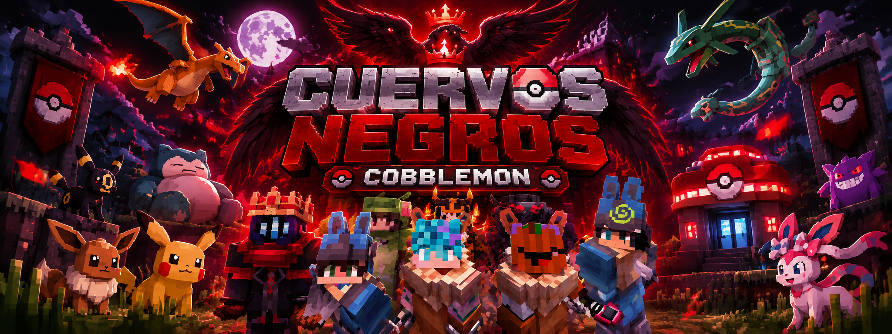

# Crianza · Cuervos Negros

Cuaderno de crianza para **Cobblemon**. Anota IVs, une crias, dibuja en la mesa y comparte con el clan.

### [Abrir el cuaderno](https://yoditagege.github.io/PaginawebCrianza/)

---

Clan **Cuervos Negros** · _yoditagg_

## Qué puedes hacer

- Guardar Pokémon con IVs, naturaleza y género  
- Unir parejas y ver pesas recomendadas  
- Dibujar y anotar en el cuaderno  
- Varias páginas, exportar e importar  
- Publicar crianzas en la **Comunidad**  
- Ver canales del clan (Twitch en vivo)

Inicia sesión con Google para subir y seguir crianzas de otros entrenadores.

---

Hecho para el clan. Usa, comparte y cría.
